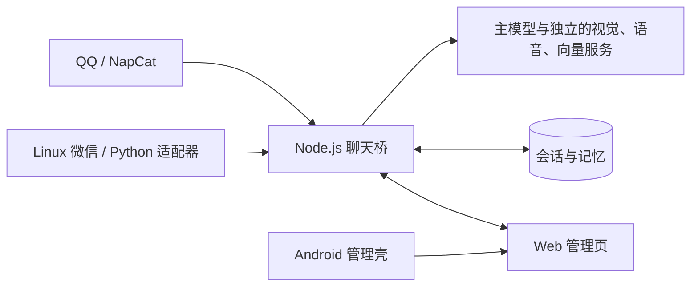

# 鲸鱼窝（WhaleNest）

鲸鱼窝是一个可自托管的 QQ 聊天助手，小鲸鱼是它的默认角色。她可以接住群聊话题、回想聊过的事，也可以调用搜索、语音和自定义能力。QQ 通过 NapCat 的 OneBot v11 接入。可选的微信桥复用已登录的 Linux 微信客户端，两端共用人设和工具，并按会话权限使用聊天记忆，本项目纯AI，零手工，纯整着玩的。



## 功能

- **聊天与人设**。合并连续发来的消息，支持群内点名、引用和免 @ 续聊。可保存多套人设，分别编辑人格、行为、说话方式和回应示例。
- **记忆与学习**。按授权从聊天里找回旧事，查看召回依据，在图谱中浏览人物和事件。群梗和表达习惯经审核后使用。
- **模型与能力**。主模型负责回复和调用工具，支持单独配置视觉、语音和 Embedding 服务。可添加插件适配器，并按渠道和调用者权限开放。 [接入能力](docs/SKILLS.md)
- **管理后台**。在仪表盘查看运行状态、资源用量、聊天活动和待审核内容。支持编辑表情包的名称、标签与使用场景，另有独立日志页。

## 服务器部署

Windows 可以直接运行，不需要 Docker。 [Windows 使用说明](docs/WINDOWS.md)

准备 Docker Compose、一个可用的模型 API，以及已登录的 NapCat。开启 NapCat 的 OneBot 正向 WebSocket，将它的 Docker 网络名、WebSocket 地址和令牌填入 `.env`。在 `OWNER_USERS` 填入自己的 QQ 号，在 `ALLOW_USERS` 和 `ALLOW_GROUPS` 配置私聊和群聊白名单。

```sh
cp .env.example .env
# 编辑 .env，填写模型 API Key、OneBot 连接信息和授权列表
# Linux：容器以 UID/GID 1000 运行，预先创建可写目录。
sudo install -d -m 0700 -o 1000 -g 1000 workspace data
docker compose config --quiet
docker compose up -d --build
curl -fsS http://127.0.0.1:3081/health
```

在宿主机浏览器访问 `http://127.0.0.1:3081/`。默认监听宿主机的回环地址，局域网访问时可将 `WEB_BIND` 改成自己的内网地址。使用 `WEB_TOKEN` 登录后台。留空或使用示例值时，服务会生成随机令牌，可在宿主机运行 `docker compose exec -T dsh-onebot cat /workspace/.web-token` 查看。

在「设置 → 模型与服务」选择主模型和其他用途，按需填写 API Key。通过后台保存的凭据使用 AES-256-GCM 加密写入设置文件，界面只显示配置状态。`.env` 中手工填写的值由部署者保管。备份时分别保存 `workspace/`、`data/` 和自己的环境配置，恢复加密设置需要 `data/` 内的配套主密钥。

Web 管理和 NapCat 使用各自的访问凭据。公网访问使用 HTTPS 反向代理。已有 Docker 安装升级前请备份配置、记忆、会话和配套主密钥，并先确认 `workspace/` 和 `data/` 对 UID/GID 1000 可读写。首次启动只补齐缺失的种子工具，已有安装需按需更新对应脚本。备份旧目录后再迁移文件所有者，升级保留原配套主密钥。

日常部署使用默认 `standard` 权限。完全放权的 Shell 和 DSH CLI 具备运行用户的权限，限管理员的 QQ 私聊和已登录的 Web 对话使用。只安装你已审阅的外部工具。

| 目录 | 内容 |
| --- | --- |
| `bridge/` | OneBot 聊天桥、模型执行、记忆、授权与 Web 管理 |
| `workspace-seed/` | 首次启动会补齐的通用工具与初始记忆文件 |
| `wechat-bridge/` | 微信桥源码、模拟驱动和语音集成 |
| `android-app/` | Android 管理壳源码、构建脚本和路由测试 |
| `build/` | 服务端镜像和初始化脚本 |
| `docs/` | 能力接入文档 |

微信需要单独配置已有会话环境。Android 下载或升级时使用自己构建的版本。 [微信桥](wechat-bridge/README.md) · [Android 构建](android-app/README.md)

微信桥会读取已授权的本地聊天数据，并操作已登录的客户端。使用前确认账号、联系人数据和平台条款允许你的使用方式。按需要开启外部模型、语音或搜索服务，相关请求可能由对应提供方处理。

## 开发验证

服务端开发环境使用 Node.js 22.19 或以上。测试使用合成账号和模拟服务。

```sh
npm ci
npm test
node --test bridge/cross-regression.test.mjs
```

微信适配器使用独立的 Python 测试。 [测试命令](wechat-bridge/README.md)

## 许可证与致谢

本项目自有代码按 **AGPL-3.0-only** 发布。微信语音模块中的上游文件保留 **GPL-3.0-or-later**，具体文件和来源见随附声明。 [项目许可证](LICENSE) · [微信语音来源与许可](wechat-bridge/voice/UPSTREAM.md)

- QQ 接入使用 OneBot v11 和 NapCat。 [NapCatQQ](https://github.com/NapNeko/NapCatQQ)
- 表达和配置设计参考了大肥鱼社区和 dsh-fish-tone。 [dafeiyu-astrbot](https://github.com/whyever77/dafeiyu-astrbot) · [dsh-fish-tone](https://github.com/MX3a48c5/dsh-fish-tone)
- 记忆设计参考了 MaiBot 的关系提取和召回思路。插件适配方案的评估参考了真寻的插件体系。 [MaiBot](https://github.com/Mai-with-u/MaiBot) · [真寻](https://github.com/zhenxun-org/zhenxun_bot)
- 独立程序和上游引用的具体来源、许可位置见第三方声明。 [第三方声明](THIRD_PARTY_NOTICES.md)

公开版的功能变化请见 [更新记录](CHANGELOG.md)。
